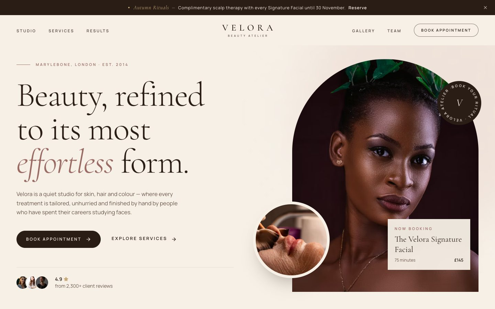
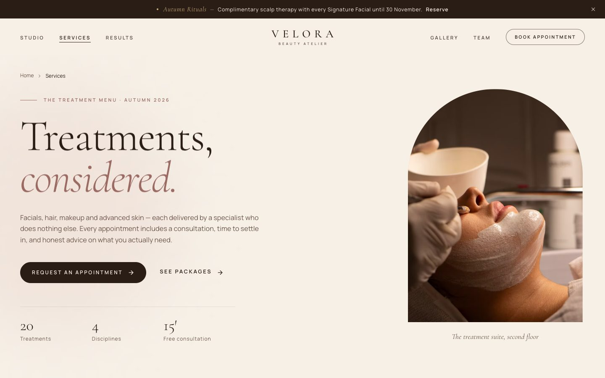
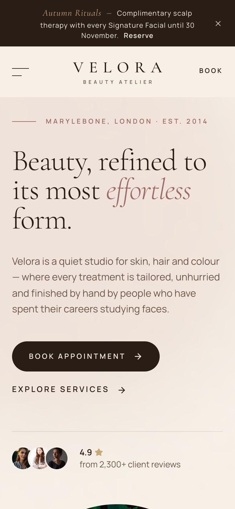
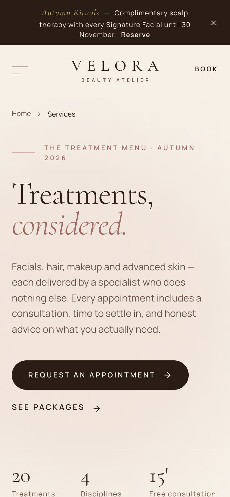

# Velora Beauty

> *Beauty, refined to its most effortless form.*

A two-page marketing site for **Velora**, a fictional editorial beauty studio on Marylebone High Street, London. The site is built to feel like a luxury print magazine: warm ivory paper, espresso type, muted rose accents and slow, considered motion.

**Live site:** <https://beauty-studio-azure.vercel.app>



## Features

- **Editorial art direction**: arch-framed photography, Cormorant Garamond display type with italic accents, and a restrained ivory, espresso, rose and champagne palette.
- **Choreographed page load**: the navigation drops in, then the eyebrow, a word-by-word masked headline, the copy and the CTAs. The hero image reveals with a clip-path wipe and a slow zoom-out.
- **Scroll storytelling**: staggered reveals, parallax on editorial imagery, count-up studio statistics and a slow keyword marquee.
- **Signature interactions**
  - A treatment menu that shows a cursor-following preview image on desktop and inline thumbnails on touch devices.
  - A draggable before/after comparison, keyboard- and screen-reader-operable through a native range input.
  - A testimonial carousel with a progress indicator that pauses on hover and focus.
  - Hover overlays on the gallery and Instagram grid, with caption reveals and a gentle zoom.
- **Services page**
  - A sticky category bar whose active pill tracks the section in view, plus a full treatment menu with duration, price and a per-treatment **Book** button.
  - Package cards, a pricing table by stylist level, the specialist team, an animated FAQ accordion and an appointment request form.
- **Booking form**: client-side validation (it rejects past dates and Mondays, when the studio is closed), inline errors, then loading and success states. "Book" buttons elsewhere pre-select the treatment.
- **Accessible by default**: semantic landmarks, a skip link, labelled controls, visible focus rings, a focus-trapped mobile menu (Esc closes it) and a native `<dialog>` for the legal notices.
- **Reduced motion**: Framer Motion runs with `reducedMotion="user"`, parallax switches off, and CSS animations are neutralised under `prefers-reduced-motion`.
- **SEO**: unique titles, descriptions and Open Graph data per page, plus a canonical URL, `sitemap.xml`, `robots.txt` and an SVG favicon.

## Pages

| Route       | Contents |
| ----------- | -------- |
| `/`         | Announcement bar, hero, discipline marquee, signature rituals, treatment menu preview, the studio and its stats, editorial quote, before/after results, testimonials, gallery, Instagram grid, booking CTA, footer with newsletter |
| `/services` | Services hero, sticky category nav, facials, hair, makeup and skin treatments, packages, pricing guide, team, FAQ, appointment request form |

## Design system

| Token          | Value     | Use |
| -------------- | --------- | --- |
| Ivory          | `#F6F0E7` | Page background |
| Ivory Deep     | `#EDE3D5` | Alternate sections |
| Espresso       | `#2A1D16` | Type, primary buttons, footer |
| Cocoa          | `#6B5548` | Secondary text |
| Muted Rose     | `#C39A91` / `#9A6A63` | Accents, italic emphasis |
| Champagne      | `#C8A978` | Sparing highlights on dark |

**Type:** Cormorant Garamond (display, light and italic) with Manrope (UI and body), both via `next/font`.

## Tech stack

- [Next.js 16](https://nextjs.org) (App Router, Turbopack, fully static output)
- React 19 + TypeScript
- Tailwind CSS v4
- Framer Motion
- Lucide icons
- Images served from the Unsplash CDN through a custom `next/image` loader (`lib/image-loader.ts`)

## Getting started

**Prerequisites:** Node.js 20.9 or newer.

```bash
npm install
```

### Development

```bash
npm run dev
```

Open <http://localhost:3000>.

### Production build

```bash
npm run build
npm start
```

### Lint

```bash
npm run lint
```

## Deployment

The project deploys to [Vercel](https://vercel.com) with zero configuration:

```bash
npx vercel --prod
```

Set `NEXT_PUBLIC_SITE_URL` to your custom domain for absolute canonical and Open Graph URLs. On Vercel the production URL is picked up automatically.

## Project structure

```
app/                 routes, layout, page transition template, SEO files
components/
  home/              home page sections
  services/          services page sections and booking form
  layout/            announcement bar, navbar, footer, newsletter, legal dialog
  motion/            Reveal, Stagger, WordReveal, Counter, Parallax
  ui/                Button, Img, SectionHeading, Accordion
lib/                 site config, content data, hooks, utilities
docs/screenshots/    README imagery
```

## Screenshots

| Home | Services |
| ---- | -------- |
|  |  |
|  |  |

## Notes

- Velora Beauty, its staff, prices, reviews and address details are fictional.
- The booking and newsletter forms validate in the browser and simulate a response. **No data is sent or stored.** Connect a booking provider or API route to take them live.
- Photography comes from [Unsplash](https://unsplash.com) and is used under the [Unsplash License](https://unsplash.com/license).

## License

Code released under the [MIT License](LICENSE).
